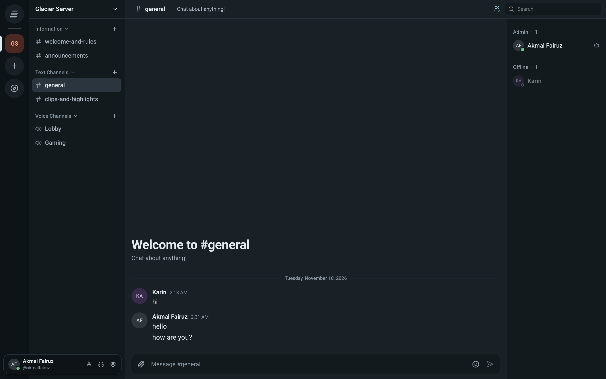
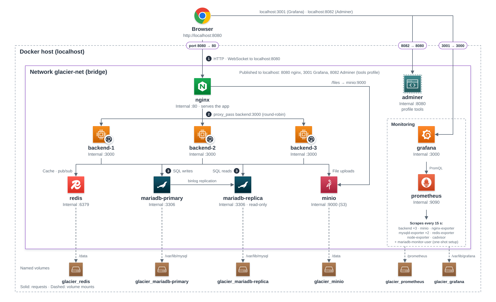

<p align="center">
  
</p>

<h1 align="center"><b>Glacier</b></h1>

<p align="center">
  A self-hosted chat app with servers, text channels, voice/video channels with
  screen sharing, direct messages (with calls), and roles and permissions.
</p>

<p align="center">
  
</p>

- **Backend**: Rust (axum, sqlx with raw SQL, no ORM), MariaDB primary + read replica, Redis, MinIO
- **Frontend**: Vite + React + TypeScript
- **Realtime**: WebSocket gateway; events fan out across backend replicas through Redis pub/sub
- **Voice / video**: WebRTC mesh (peer-to-peer); the backend relays signaling only. Public STUN only, with no TURN relay.

## Why this project

A Discord-like chat app needs many cooperating services (proxy, scaled API, replicated database,
cache and pub/sub, object storage, monitoring), which makes it a good fit for a containerized
cloud setup.

## Architecture

<p align="center">
  
</p>

## Run everything

From a fresh clone:

```sh
cp .env.example .env   # then change the passwords in .env
docker compose up -d --build
```

Open http://localhost:8080 and register an account. Grafana is on http://localhost:3001.

`.env` holds every password and user name (MariaDB, replication, the exporters, MinIO and Grafana);
`.env.example` lists the same variables with placeholder values, and `.env` is ignored by git.
MariaDB and MinIO keep the credentials they were first started with, so set them before the first
`up`.

Optional tools and publishing:

```sh
docker compose --profile tools up -d adminer   # Adminer on http://localhost:8082 (server: mariadb-primary)
docker compose push backend nginx              # publish DOCKERHUB_USER/glacier-*:GLACIER_VERSION
```

| Service                            | Purpose                                                         |
| ---------------------------------- | --------------------------------------------------------------- |
| `nginx`                            | Serves the built frontend; proxies `/api`, `/gateway`, `/files` |
| `backend` (×3)                     | Stateless API + gateway replicas                                |
| `mariadb-primary`                  | Writes, binlog source                                           |
| `mariadb-replica`                  | Read-only replica used for listing queries                      |
| `redis`                            | Sessions, cache, rate limits, presence, voice state, pub/sub    |
| `minio`                            | Uploaded files (bucket `glacier-uploads`, public read)          |
| `prometheus`, `grafana`, exporters | Monitoring (see [Monitoring](#monitoring))                      |
| `adminer` (profile `tools`)        | Database admin UI                                               |

Scale the backend: `docker compose up -d --scale backend=5`. nginx re-resolves
the `backend` service name every 10 seconds, so it picks up new replicas.

## API

- Health: http://localhost:8080/health (also `/api/health`)
- Swagger UI: http://localhost:8080/api/docs
- Spec: http://localhost:8080/api/openapi.json (a copy is committed as split YAML in `openapi/`)
- Gateway: `ws://localhost:8080/gateway?token=<token>` (frames are `{op,d}` from the client and `{t,d}` from the server)

The spec is generated from the Rust handlers (utoipa) and written as YAML split across files:

```
openapi/
  openapi.yaml                    entry point: info, tags, security; $refs to everything else
  paths/<tag>/<path>.yaml         one path per file, grouped by tag (e.g. paths/channels/servers_id_channels.yaml)
  components/schemas/<Name>.yaml  one schema per file
```

The files are generated, so don't edit them by hand. After changing the API:

```sh
cd backend && cargo run -q -- openapi      # rewrites ../openapi/
cd ../frontend && npm run gen:api          # TypeScript types from openapi/openapi.yaml
```

## Monitoring

Grafana runs at http://localhost:3001 (login from `GRAFANA_ADMIN_*` in `.env`) with Backend, Data services,
and Host and containers dashboards. Prometheus scrapes the backend replicas, exporters for
MariaDB, Redis and nginx, MinIO, node-exporter and cAdvisor. Only Grafana is published to the
host. Alert rules are in `monitoring/prometheus/rules/`.

## Local development

Start the data services with Docker and run the apps on the host:

```sh
docker compose up -d mariadb-primary mariadb-replica redis minio
```

Docker Compose doesn't publish the data service ports. For host development, add a
`docker-compose.override.yml` that maps them (`3306`, `6379`, `9000`), then:

```sh
cd backend && cargo run            # http://localhost:3000; set DATABASE_URL and S3_* to match your .env
cd frontend && npm install && npm run dev
```

Without `DATABASE_READ_URL`, the backend reads from the primary.

## Checks

```sh
cd backend && cargo fmt --check && cargo clippy --all-targets -- -D warnings && cargo test
cd frontend && npm run format:check && npm run typecheck && npm run lint && npm run build
```

Format with `cargo fmt` and `npm run format`.

## Layout

```
backend/    Rust crate: one module per feature (handlers.rs, repo.rs with raw SQL, models.rs)
docs/       README screenshot and architecture diagram
frontend/   React app: src/ui (primitives), src/features/* (feature components and hooks)
monitoring/ Prometheus config and alert rules, Grafana provisioning and dashboards
nginx/      Reverse proxy config (baked into the frontend image)
openapi/    Generated OpenAPI spec (YAML, split per path and schema)
```

## Notes

- Without a TURN server, calls between users behind strict NATs may fail to connect.
- Bots and integrations are not implemented yet.

## License

[MIT](LICENSE)
